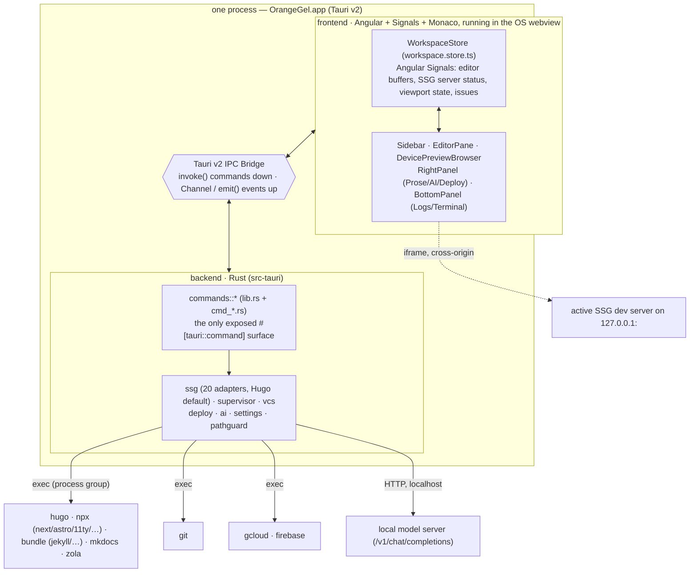
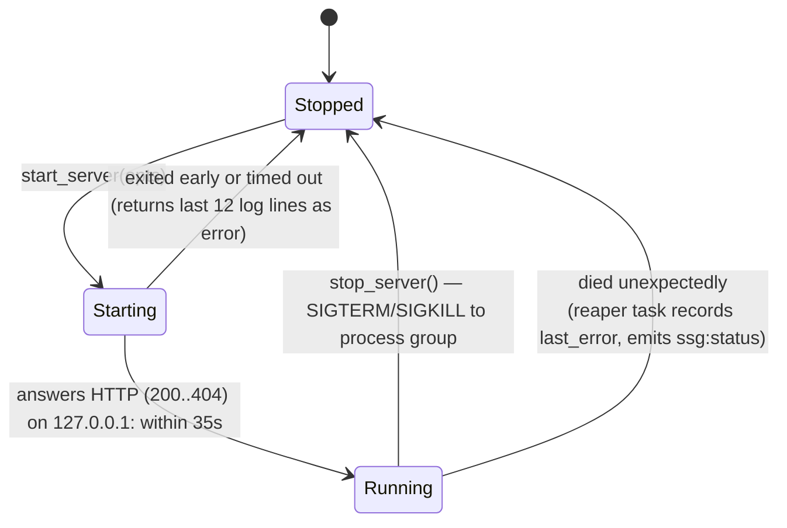
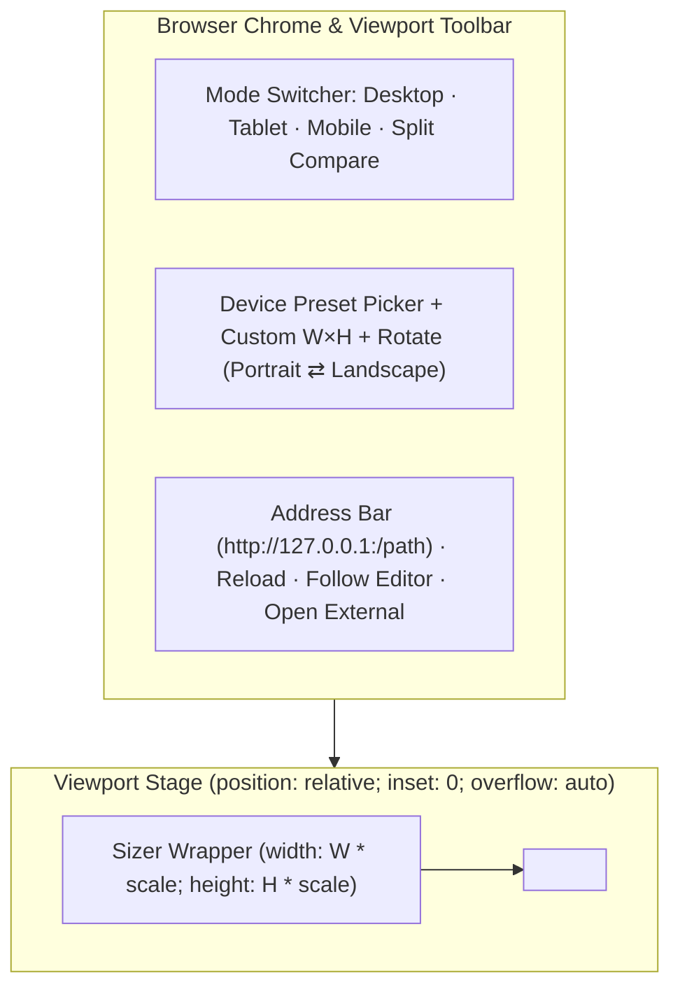

# OrangeGel — Design

How OrangeGel is put together, what it inherits from `DESIGN.md`, and where it diverges. Read this before changing anything structural.

OrangeGel is the successor to OrangeGelCore. It lives across three repositories under [`github.com/orangegel`](https://github.com/orangegel):
- **[`github.com/orangegel/orangegel`](https://github.com/orangegel/orangegel)** — The native Tauri v2 + Angular 19 desktop application itself.
- **[`github.com/orangegel/site`](https://github.com/orangegel/site)** — The official OrangeGel website, built with **Hugo** (dogfooding OrangeGel's flagship generator).
- **[`github.com/orangegel/docs`](https://github.com/orangegel/docs)** — The official OrangeGel documentation and Top-20 SSG adapter guides.

Four foundational shifts define the application:

1. **Tauri v2 replaces Wails + Go.** The backend is now Rust (`src-tauri/`), communicating with the OS webview (`WKWebView` on macOS, `WebView2` on Windows, `WebKitGTK` on Linux) over Tauri v2's IPC command and event bridge.
2. **Angular + Tailwind CSS + Lucide Icons + TypeScript + Monaco + Three.js + Anime.js + Mermaid replaces Svelte 5.** State still lives in one centralized reactive store (`WorkspaceStore` using Angular Signals), and editor buffers remain owned by the store rather than the Monaco component. **Tailwind CSS** and **Lucide (`lucide-angular`)** style the entire IDE shell with crisp 1.75px vector iconography and citrus-gel glassmorphism tokens while obeying WebKit layout rules; **Three.js** and **Anime.js** power spatial visualizations and spring-physics viewport transitions; and **Mermaid** powers live diagram rendering in both the Markdown authoring inspector and the interactive Deploy/Architecture pipelines.
3. **Top 20 Static Site Generators (SSGs) from [jamstack.org/generators](https://jamstack.org/generators/) are first-class citizens — with Hugo first among equals.** Instead of hardcoding `hugo` throughout the backend, OrangeGel introduces a unified Rust `SsgAdapter` trait while retaining deep Hugo-first ergonomics (archetypes, shortcodes, Go template completions, `hugo.toml` precedence).
4. **Multi-Device Responsive Preview Browser & 3D Site Graph.** The preview pane is an interactive device studio supporting **Desktop**, **Tablet**, and **Mobile** viewports, Anime.js spring-morphed portrait/landscape rotation, zoom/auto-fit sizer scaling, URL route bar, optional side-by-side viewport comparison, and a **Three.js 3D Site Topology Graph**.

---

## 1. The shape of it

One native Tauri v2 process (`OrangeGel.app`). Inside it, two halves that only ever speak through a typed IPC bridge:



Two invariants carried straight from OrangeGelCore:

1. **The frontend has no filesystem, no network, and no subprocesses.** Tauri v2 capabilities (`src-tauri/capabilities/default.json`) grant the webview *only* access to OrangeGel's own `#[tauri::command]` handlers — never raw `fs` or `shell` plugin wildcards from JavaScript. That keeps the path guard in §9 a real security boundary.
2. **The OS webview is the only renderer.** No bundled Chromium. The preview browser renders the live SSG server inside the native webview via a responsive device stage (`<iframe>`), with `open_in_system_browser` as the escape hatch.

---

## 2. The Tauri v2 bridge

Everything crossing the boundary goes one of two ways:

| Direction | Mechanism | Used for |
|---|---|---|
| Angular → Rust | `invoke<T>(cmd, args)` (`#[tauri::command]`) | Every action: open project, detect SSG, read/write file, start/stop dev server, build, git, deploy |
| Rust → Angular | `app.emit(event, payload)` / `tauri::ipc::Channel` | Streaming dev-server stdout/stderr, server status changes, deploy pipeline progress, project switch |

### Command surface organization

The Rust command surface is split by domain — `cmd_project.rs`, `cmd_ssg.rs`, `cmd_preview.rs`, `cmd_git.rs`, `cmd_deploy.rs`, `cmd_ai.rs`, `cmd_settings.rs` — with `state.rs` holding `AppState` behind thread-safe locks (`Mutex` / `RwLock`) and the two guards every project-bound command starts with:

```rust
let proj = state.require_project()?;        // Err("No project is open")
let adapter = state.require_ssg(&proj)?;    // Re-resolves the active SSG binary/toolchain before failing
```

Re-resolving the SSG binary on demand matters: if a user opens an Astro or Hugo site, sees `"hugo not found"` or `"node/npx not found"`, installs the tool in their terminal, and clicks **Start Server** again, it works immediately without relaunching OrangeGel.

### Named events

Mirrored between `src-tauri/src/events.rs` and `src/app/core/bridge/events.ts`:

```text
ssg:log          one line of dev-server or build output (with stream + level metadata)
ssg:status       dev server transitioned: Stopped | Starting | Running { url, port, ssg } | Died { error }
deploy:event     one step of the GCP / Firebase Hosting / Cloud Run deploy pipeline
project:changed  a different site was opened or its SSG adapter was switched
```

### Preserved bridge asymmetries

- **Build & command failures return output *with* the error.** A failed `ssg_build` returns `CommandResult { ok: false, exit_code, stdout, stderr, error }` rather than a bare string error so the user can see the compiler/template failure line.
- **Cancelled native dialogs are not errors.** `choose_project` returns `Ok(None)` when the user cancels the native folder picker (`tauri-plugin-dialog`); `git_push` returns `Ok(None)` when the user declines confirmation.

---

## 3. State lives in one place (Angular Signals)

`src/app/core/state/workspace.store.ts` is an `@Injectable({ providedIn: 'root' })` store built on **Angular Signals** (`signal`, `computed`, `effect`).

Just like OrangeGelCore's `state.svelte.ts`, **editor buffers live in `WorkspaceStore`, never inside `MonacoEditorComponent`**. As panes split, resize, or switch between Code, Split, and Full-Browser Preview modes, the Monaco view can be destroyed and recreated at any time without losing unsaved edits, undo stacks, or dirty status.

```ts
export interface EditorTab {
  path: string;
  name: string;
  lang: string;
  isDoc: boolean;                      // Content document → front-matter form + body; else code/config
  format: 'yaml' | 'toml' | 'json' | 'none';
  fields: Record<string, unknown>;     // Live front-matter fields
  body: string;                        // Live markdown/content body
  savedFieldsJson: string;             // Snapshot on disk
  savedBody: string;                   // Snapshot on disk
}
```

Dirty state is a `computed()` signal:
```ts
isDirty(tab: EditorTab): boolean {
  return tab.body !== tab.savedBody || JSON.stringify(tab.fields) !== tab.savedFieldsJson;
}
```

A non-reactive callback reference `revealInEditor: ((offset: number, length: number) => void) | null = null` is registered by `MonacoEditorComponent` so the Prose & AI panel can jump the cursor directly to a flagged span without coupling layout layers.

---

## 4. The Generator is the authority (Top 20 SSGs, Hugo Preferred)

OrangeGelCore's golden rule was *"where Hugo already has an answer, don't compute a second one."* OrangeGel generalizes this rule across the **Top 20 Static Site Generators from [jamstack.org/generators](https://jamstack.org/generators/)**, while keeping **Hugo** as the preferred default and deepest integration.

### The `SsgAdapter` trait

Every generator implements a single trait in `src-tauri/src/ssg/mod.rs`:

```rust
pub trait SsgAdapter: Send + Sync {
    fn id(&self) -> SsgId;
    fn display_name(&self) -> &'static str;
    fn is_preferred(&self) -> bool { false } // true for Hugo
    fn detect(&self, root: &Path) -> Option<DetectionMatch>;
    fn resolve_binary(&self, root: &Path, override_bin: Option<&str>) -> Result<ResolvedToolchain, SsgError>;
    fn dev_command(&self, root: &Path, port: u16, opts: &DevOptions) -> CommandSpec;
    fn build_command(&self, root: &Path, opts: &BuildOptions) -> CommandSpec;
    fn new_content(&self, root: &Path, rel_path: &str) -> ScaffoldStrategy;
    fn content_dirs(&self, root: &Path) -> Vec<PathBuf>;
    fn output_dir(&self, root: &Path) -> PathBuf;
    fn preview_url_path(&self, rel_path: &str) -> String;
}
```

### Supported Top 20 Generators Matrix

Detection runs in priority order (checking explicit `.orangegel/project.json` override first, then **Hugo** first among structural markers, then specific config filenames, then `package.json` dependencies / `Gemfile` / `pyproject.toml`):

| # | Generator | Ecosystem | Detection Markers | Dev Server Command (Port Injected) | Build Command | Default Output Dir | Content Directories |
|---|---|---|---|---|---|---|---|
| 1 | **Hugo** *(Preferred)* | Go | `hugo.toml`, `hugo.yaml`, `hugo.json`, `config.toml` + `content/` or `archetypes/` | `hugo server --port <P> --bind 127.0.0.1 [--buildDrafts]` | `hugo --gc [--minify]` | `public/` | `content/` |
| 2 | **Next.js** | JS/TS (React) | `next.config.{js,mjs,ts}` or `package.json` (`next`) | `npx next dev --port <P> --hostname 127.0.0.1` | `npx next build` | `out/` or `.next/` | `src/app/`, `app/`, `pages/`, `content/` |
| 3 | **Docusaurus** | JS/TS (React) | `docusaurus.config.{js,ts,mjs}` | `npx docusaurus start --port <P> --host 127.0.0.1 --no-open` | `npx docusaurus build` | `build/` | `docs/`, `blog/`, `src/pages/` |
| 4 | **Nuxt** | JS/TS (Vue) | `nuxt.config.{js,ts,mjs}` | `npx nuxi dev --port <P> --host 127.0.0.1` | `npx nuxi generate` | `.output/public/` or `dist/` | `content/`, `pages/` |
| 5 | **Gatsby** | JS/TS (React) | `gatsby-config.{js,ts,mjs}` | `npx gatsby develop --port <P> --host 127.0.0.1` | `npx gatsby build` | `public/` | `src/pages/`, `content/` |
| 6 | **Astro** | JS/TS | `astro.config.{mjs,ts,js}` | `npx astro dev --port <P> --host 127.0.0.1` | `npx astro build` | `dist/` | `src/content/`, `src/pages/` |
| 7 | **Jekyll** | Ruby | `_config.yml` (+ `Gemfile` with `jekyll` or `_posts/`) | `bundle exec jekyll serve --port <P> --host 127.0.0.1 --livereload` | `bundle exec jekyll build` | `_site/` | `_posts/`, `_drafts/`, root `.md` |
| 8 | **Hexo** | JS/Node | `_config.yml` + `package.json` (`hexo`) | `npx hexo server -p <P> -i 127.0.0.1` | `npx hexo generate` | `public/` | `source/_posts/`, `source/` |
| 9 | **VuePress** | JS/TS (Vue) | `.vuepress/config.{js,ts}` or `docs/.vuepress/config.{js,ts}` | `npx vuepress dev docs --port <P> --host 127.0.0.1` | `npx vuepress build docs` | `docs/.vuepress/dist/` | `docs/` |
| 10 | **Eleventy (11ty)** | JS/Node | `eleventy.config.{js,mjs,cjs}`, `.eleventy.js` | `npx @11ty/eleventy --serve --port=<P>` | `npx @11ty/eleventy` | `_site/` | `src/`, `content/`, `posts/` |
| 11 | **VitePress** | JS/TS (Vue) | `.vitepress/config.{js,ts,mts}` or `docs/.vitepress/config.{js,ts,mts}` | `npx vitepress dev docs --port <P> --host 127.0.0.1` | `npx vitepress build docs` | `docs/.vitepress/dist/` | `docs/` |
| 12 | **MkDocs** | Python | `mkdocs.yml` or `mkdocs.yaml` | `mkdocs serve --dev-addr 127.0.0.1:<P>` | `mkdocs build` | `site/` | `docs/` |
| 13 | **Zola** | Rust | `config.toml` + `templates/` + `content/` (with Tera `[markdown]`/`base_url`) | `zola serve --port <P> --interface 127.0.0.1` | `zola build` | `public/` | `content/` |
| 14 | **Pelican** | Python | `pelicanconf.py` | `pelican --listen --port <P> --bind 127.0.0.1 --autoreload` | `pelican content -s publishconf.py` | `output/` | `content/` |
| 15 | **SvelteKit** | JS/TS (Svelte) | `svelte.config.{js,ts}` | `npx vite dev --port <P> --host 127.0.0.1` | `npx vite build` | `build/` | `src/routes/`, `src/content/` |
| 16 | **Remix / React Router** | JS/TS (React) | `react-router.config.{ts,js}` or `vite.config.*` with `@remix-run/dev` | `npx vite dev --port <P> --host 127.0.0.1` | `npx vite build` | `build/client/` | `app/routes/`, `content/` |
| 17 | **Middleman** | Ruby | `config.rb` + `Gemfile` (`middleman`) | `bundle exec middleman server -p <P> -b 127.0.0.1` | `bundle exec middleman build` | `build/` | `source/` |
| 18 | **Metalsmith** | JS/Node | `metalsmith.{js,json}` or `package.json` (`metalsmith`) | `npx browser-sync start --server build --port <P> --no-open` (or npm `dev`/`start`) | `node metalsmith.js` / `npm run build` | `build/` | `src/` |
| 19 | **Gridsome** | JS/Vue | `gridsome.config.js` | `npx gridsome develop --port <P> --host 127.0.0.1` | `npx gridsome build` | `dist/` | `src/pages/`, `content/` |
| 20 | **Bridgetown** | Ruby | `bridgetown.config.yml` or `config/initializers.rb` | `bin/bridgetown start -p <P> -b 127.0.0.1` | `bin/bridgetown build` | `output/` | `src/_posts/`, `src/` |

### Why Hugo remains first-class

- **New site wizard** defaults to **Hugo** (`hugo new site <path> --format toml`), while also offering quick-starters or existing-folder import for all 20 generators.
- **Content scaffolding (`new_content`)** delegates directly to the CLI where native scaffolding exists (`hugo new content <path>`, `npx hexo new <title>`, `zola` / `jekyll` / `bridgetown` conventions), and falls back to generating standard front matter (`---` YAML or `+++` TOML with `title`, `date`, `draft: true`) for generators without a CLI scaffolder.
- **Monaco completions** retain Hugo's dedicated Go-template/shortcode completion provider and TOML Monarch grammar, alongside MDX/Astro/Liquid/Nunjucks/Jinja2 syntax awareness.

---

## 5. Supervising the SSG dev server

`supervisor::ServerSupervisor` in Rust owns at most one active child process group at a time. Its state machine is identical to OrangeGelCore's, generalized across all 20 generators:



1. **Dynamic free port (`free_port()`).** Binds `TcpListener::bind("127.0.0.1:0")`, reads the OS-assigned port, drops the listener, and passes that port to the active `SsgAdapter::dev_command`. Never assumes `:1313`, `:3000`, `:4321`, or `:8080` is free.
2. **Readiness is HTTP, not stdout parsing.** Node-based frameworks (Next.js, Gatsby, Nuxt, Docusaurus) can take longer than Hugo on cold cache, so the readiness poller checks `http://127.0.0.1:<port>/` every 200ms for up to **35 seconds** (configurable). Any HTTP response from the socket counts as ready. If it fails or exits early, the error includes the **last 12 lines of the ring buffer**.
3. **Process group isolation (`process_group(0)` on Unix).** Node (`npx`), Ruby (`bundle exec`), and Hugo all spawn child watchers. Putting the child in its own process group (`nix::sys::signal::killpg` / `libc::kill(-pgid, SIGTERM)`) guarantees that stopping the server or quitting OrangeGel (`RunEvent::Exit`) never leaks an orphaned node/hugo/ruby watcher holding the port.
4. **Thread-safe 500-line ring buffer.** Two Tokio tasks pump stdout and stderr into a `Mutex<VecDeque<LogLine>>` (capped at 500 lines) and emit `ssg:log` events to Angular. Deprecation warnings (`deprecated`, `ExperimentalWarning`) are tagged as `warn`/`info` rather than `error` so noisy Node or Hugo theme warnings don't cry wolf.

---

## 6. The Responsive Device Preview Browser

OrangeGel elevates OrangeGelCore's preview iframe into a full **Multi-Device Preview Browser** (`DevicePreviewBrowserComponent`) so authors can inspect their site in **Desktop**, **Tablet**, and **Mobile** modes without leaving the app.



### Built-in Viewport Modes & Presets

| Category | Preset Name | Dimensions (Portrait / Default) | Rotatable? | Notes |
|---|---|---|---|---|
| **Desktop** | Responsive Fluid | `100% × 100%` | No | Fills the preview pane naturally |
| **Desktop** | Laptop (13") | `1280 × 800` | No | Scales down via sizer if pane is narrower |
| **Desktop** | Desktop HD | `1440 × 900` | No | Standard wide desktop breakpoint |
| **Desktop** | Desktop 1080p | `1920 × 1080` | No | Full HD widescreen check |
| **Tablet** | iPad Mini / Standard | `768 × 1024` | Yes (`1024 × 768`) | Classic `md`/`lg` CSS breakpoint boundary |
| **Tablet** | iPad Air | `820 × 1180` | Yes (`1180 × 820`) | Modern tablet viewport |
| **Tablet** | iPad Pro 12.9" | `1024 × 1366` | Yes (`1366 × 1024`) | Large tablet / touch laptop |
| **Mobile** | iPhone SE | `375 × 667` | Yes (`667 × 375`) | Small mobile screen floor |
| **Mobile** | iPhone 16 Pro | `393 × 852` | Yes (`852 × 393`) | Primary modern iOS viewport |
| **Mobile** | Pixel 9 / Android | `412 × 915` | Yes (`915 × 412`) | Primary modern Android viewport |
| **Compare** | Side-by-Side (Desktop + Mobile) | `1280×800` + `393×852` | Yes | Renders synchronized dual iframes to spot breakpoint regressions |

### Preserving the WebKit Sizer Invariant

From `DESIGN.md` §7:
- **A CSS `transform: scale(s)` does not shrink the DOM layout box.** If a `1440×900` Desktop or `393×852` Mobile frame is scaled to `65%` to fit the pane (`Auto-Fit` zoom mode), wrapping it in an unscaled container leaves ghost scrollbars or clips the bottom in `WKWebView`.
- **The Sizer Wrapper Fix:** A `ResizeObserver` on the stage computes `scale = Math.min(1, availWidth / deviceWidth, availHeight / deviceHeight)` when `Auto-Fit` is active (or uses the user's explicit zoom `50% / 75% / 100%`). The outer `.viewport-sizer` div is given explicit pixel dimensions `width: deviceWidth * scale; height: deviceHeight * scale`, and the inner `<iframe>` is given `width: deviceWidth; height: deviceHeight; transform: scale(scale); transform-origin: top left`.
- **Cross-origin by design:** The app runs on `tauri://localhost` (or `http://localhost:1420` in dev) and the preview runs on `http://127.0.0.1:<port>`. We never reach into `contentWindow`:
  - **Reload:** Increment `reloadToken` signal, re-binding the iframe `src` (or recreating via `@for` track key).
  - **Address bar navigation:** Users can type any relative route (e.g., `/blog/my-post` or `/docs/intro`) in the browser bar to navigate the iframe directly.
  - **Follow Editor:** Switching editor tabs computes `adapter.preview_url_path(rel_path)` in Rust and updates the iframe URL when `followEditor()` is enabled.

---

## 7. The Editor (Angular + Monaco)

1. **Curated tree-shaken languages.** `monaco.config.ts` imports only the languages static site authors touch (`markdown`, `html`, `yaml`, `json`, `css`, `scss`, `javascript`, `typescript`, `go`, `ruby`, `python`, `rust`, `xml`) plus our custom **TOML Monarch grammar** (with date-before-number ordering so `2026-10-20` isn't tokenized as subtraction).
2. **One `ITextModel` per file in a `Map<string, ITextModel>`.** Preserves per-tab undo/redo (`⌘Z`) across tab switches and layout mode changes.
3. **Custom completion providers:**
   - **Hugo Go-templates & shortcodes** (`partial`, `range where`, ``, ``, Hugo Pipes asset pipeline).
   - **Tailwind CSS Utility Completions:** Context-aware completions for Tailwind classes inside `class="..."` / `className="..."` across HTML, Markdown, Hugo templates, Astro, JSX/TSX, Vue, and Svelte files.
   - **Mermaid Diagram Completions & Grammar:** Syntax highlighting and snippet templates for `flowchart`, `sequenceDiagram`, `stateDiagram-v2`, `classDiagram`, `erDiagram`, and `xychart-beta` inside ```` ```mermaid ```` fences and Hugo `` shortcodes.
   - **Three.js & Anime.js Authoring Snippets:** Completions for embedding Three.js WebGL canvases, responsive camera/renderer loops, shader materials, and Anime.js timelines/staggers inside Hugo shortcodes, Astro/MDX islands, or HTML/TS files.
   - **Lucide Icon Completions & Shortcodes:** Completions for inline Lucide SVG icons, Hugo `` shortcodes, and `lucide` icon names across Markdown, HTML, Astro, and JSX/TSX templates.
   - **HTMX** (`hx-*` attributes and fixed-vocabulary attribute values).
   - **SSG Front-Matter snippets** tailored to the active generator (`draft`, `slug`, `tags`, `layout`, `sidebar_position` for Docusaurus, etc.).
4. **The WebKit Layout Rule (`DESIGN.md` §6) with Tailwind CSS:**
   > **Never size a pane with a percentage height (`h-full`) inside a flex column.**
   Every flex-child pane hosting Monaco, Mermaid, Three.js, or the Device Preview Stage uses Tailwind's `relative flex-1 min-h-0` on the wrapper and `absolute inset-0` on the child container so `WKWebView` never collapses it to `0px`.
5. **Degrade, never blank.** `monaco.editor.create()` is wrapped in `try / catch`. If WebGL/workers fail to initialize, `MonacoEditorComponent` swaps in a fallback `<textarea>` bound to the exact same `WorkspaceStore` buffer signal with an explanatory banner.

---

## 7b. Spatial UI, Diagrams, Iconography & Motion Design (Tailwind CSS + Lucide + Three.js + Anime.js + Mermaid)

OrangeGel combines **Tailwind CSS**, **Lucide (`lucide-angular`)**, **Three.js** (`three`), **Anime.js** (`animejs`), and **Mermaid** (`mermaid`) deliberately—where utility-first styling, crisp vector iconography, spatial visualization, live diagramming, and tactile physics genuinely clarify state or accelerate static site authoring:

### Where Tailwind CSS & Lucide Icons (`lucide-angular`) are used
1. **OrangeGel IDE Shell & Citrus-Gel Design System:**
   - All Angular standalone components use Tailwind CSS with custom CSS variables (`--og-amber`, `--og-citrus`, `--og-surface`, `--og-border`) for dark/light mode, subtle `backdrop-blur` glass headers, and high-density IDE panels.
   - Enforces WebKit flex safety (`relative flex-1 min-h-0` + `absolute inset-0`) instead of `h-full` inside flex columns.
2. **Tree-Shaken Lucide Icon System (`lucide-angular`):**
   - Provides consistent `1.75px`-stroke vector icons (`<lucide-icon [img]="..." class="w-4 h-4">`) registered via selective tree-shaken imports so only the icons OrangeGel actually renders are bundled:
     - **Device Preview Studio:** `Monitor` (Desktop), `Tablet` (Tablet), `Smartphone` (Mobile), `Columns2` (Side-by-Side Compare), `Orbit` / `Network` (3D Site Graph), `RotateCw` (Portrait ⇄ Landscape rotation), `ZoomIn` / `Maximize2` (Auto-Fit & Zoom), `RefreshCw` (Reload), `Compass` / `Link2` (Follow Editor), `ExternalLink` (Open in System Browser).
     - **File Tree & SSG Switcher:** `Folder`, `FolderOpen`, `FileText` (Markdown/Content), `FileCode` (Templates/Code), `Settings2` (Config), `Sparkles` / `Flame` (Hugo flagship badge & AI actions), `Play` / `Square` (Start/Stop SSG Dev Server), `Hammer` (Production Build).
     - **Prose, AI, Git & Deploy Panels:** `SpellCheck`, `WandSparkles` (AI Proofread/Tighten/Clarity), `GitBranch`, `GitCommitHorizontal`, `UploadCloud`, `Rocket`, `CheckCircle2`, `AlertTriangle`, `XCircle`, `Terminal`.
3. **Authoring Support:**
   - Provides Tailwind utility completions and Lucide icon name/shortcode completions inside Monaco, and detects `tailwind.config.*` / `@tailwindcss/vite` / PostCSS in open SSG projects.

### Where Mermaid is used
1. **Live Mermaid Diagram Inspector (`MermaidPreviewComponent`):**
   - Whenever the active Markdown/MDX/Hugo document contains one or more ```` ```mermaid ```` code fences or `` shortcodes, the Inspector / Preview drawer renders them live via `mermaid.render()` synchronized with OrangeGel's dark/light citrus theme.
   - Includes interactive pan/zoom, one-click SVG copy/export, and syntax error diagnostics mapped back to the exact fence line in Monaco.
2. **Interactive Deploy Pipeline & SSG Architecture Graphs:**
   - The Deploy panel renders the live 5-step deployment plan (Preflight → SSG Build → Cloud Build → Cloud Run `@sha256` → Firebase Hosting Edge Purge → Hash Verification) as a live status-colored Mermaid diagram whose active node highlights in real time as `deploy:event` messages stream from Rust.
3. **Prose Masking (`prose.service.ts`):**
   - Masks ```` ```mermaid ... ``` ```` and `...` regions with equal-length spaces so Hunspell never flags diagram syntax (`flowchart`, `subgraph`, `-->`) as spelling mistakes.

### Where Three.js is used
1. **3D Site Topology & Content Graph (`SiteGraph3DComponent`):**
   - A toggleable mode in the Preview/Inspector pane that renders the open static site's content hierarchy, sections, tags/taxonomies, and internal markdown links as an interactive 3D force-directed constellation in Three.js (`InstancedMesh` nodes + line segments + raycast hover/click).
   - Color-codes nodes by status (`published`, `draft`, `section`, `taxonomy`, `broken-link`). Clicking any node opens that document in Monaco and navigates the Device Preview Browser to its route.
2. **Interactive "Orange Gel" Shader Orb (`OrangeGelOrbComponent`):**
   - Rendered on the Welcome / Empty-Project screen and as a compact reactive status jewel in the top toolbar.
   - Uses a custom GLSL fresnel/gel vertex displacement shader whose uniform state smoothly reflects the SSG server lifecycle (`Stopped` calm amber → `Starting` energetic ripple → `Running` luminous citrus glow → `Deploying` orbital pulse → `Error` crimson spike).
3. **WebGL Lifecycle & Degradation Rules:**
   - Every Three.js canvas pauses its `requestAnimationFrame` loop via `IntersectionObserver` / `document.visibilityState` when the tab or pane is hidden, disposes geometries/materials/renderers in `ngOnDestroy`, and wraps `new THREE.WebGLRenderer()` in `try/catch` with a clean SVG fallback so a missing WebGL context never blanks a pane.

### Where Anime.js is used
1. **Spring-Physics Viewport & Orientation Morphing (`DevicePreviewBrowserComponent`):**
   - Switching between **Desktop → Tablet → Mobile** presets or clicking **Rotate (`Portrait ⇄ Landscape`)** uses Anime.js spring physics (`spring(1, 80, 12, 0)`) to smoothly interpolate `.viewport-sizer` width, height, scale, and device bezel border-radius so the user visually sees how their site reflows across breakpoints during the transition.
2. **Deploy Pipeline & Server Readiness Choreography:**
   - Uses `anime.timeline()` to animate step progression across the 5-stage deploy pipeline (Preflight → SSG Build → Cloud Run `@sha256` → Firebase Hosting Edge Purge → Hash Verification) and staggered log/issue card entrances (`anime.stagger(35)`).
3. **Reduced-Motion Respect:**
   - A central `MotionService` checks `window.matchMedia('(prefers-reduced-motion: reduce)')` and drops durations to `0ms` when requested by the OS.

---

## 8. Prose checking and Local AI Proofreading

Carried forward directly from `DESIGN.md` §8:

### Mask, then scan (`prose.service.ts`)
- Before running Hunspell (`nspell` with vendored `en` dictionary loaded lazily on first content tab) or deterministic style rules, all non-prose regions are replaced with **equal-length spaces**:
  - Fenced & indented code blocks, inline code
  - Hugo shortcodes (``, `{}`) and Go template actions (`{{ ... }}`)
  - MDX/Astro/Vue JSX component tags (`<Callout ...>`) and Liquid/Jinja tags (``)
  - HTML tags, entities, URLs, Markdown links/references, LaTeX math (`$...$`, `$$...$$`), emails
- Preserving exact byte/character offsets means every issue maps 1:1 onto Monaco markers (squiggles) and quick-fix code actions without an offset translation table.
- Per-project dictionary lives at **`<site>/.orangegel/dictionary.txt`** (with backward-compatible fallback read from `.orangegel-legacy/dictionary.txt` if present!).

### The model never silently writes (`src-tauri/src/ai.rs`)
- Speaks OpenAI-compatible `POST /v1/chat/completions` (`http://localhost:11434/v1` default for Ollama, LM Studio, or `llama.cpp`).
- Three modes: **Proofread** (default), **Tighten**, **Clarity** at `temperature: 0.0`.
- Caps input at **12,000 characters** on a paragraph boundary and re-attaches the untouched tail so a small local context window can never truncate a long post.
- `clean_response()` strips `<think>...</think>` blocks, conversational preambles, and outer-only markdown code fences.
- Returns a suggestion rendered as a **word-level diff** in the UI; clicking **Apply** verifies the buffer hasn't changed since the request started and only updates the unsaved buffer (`⌘S` remains explicit).

---

## 9. Trust boundaries

1. **Every path resolves through `PathGuard::abs` / `PathGuard::rel` (`src-tauri/src/pathguard.rs`).** Canonicalizes the project root and target path, rejecting any `..` traversal, symlink escape outside the project root, or raw absolute path (`/etc/passwd`).
2. **Native OS confirmation dialogs (`tauri-plugin-dialog`) for outward or destructive actions:**
   - `git_push`: Names the remote and remote URL.
   - `run_deploy`: Names the SSG build command, Firebase Hosting site, GCP project, Cloud Run service, region, and `app`/`env` billing labels.
   - `delete_file`: Confirms permanent deletion of the relative path.
3. **Project root is owned by `AppState` in Rust, never passed from Angular.**
4. **Zero credential handling.** `vcs` shells out to `git`, and `deploy` shells out to `gcloud` and `firebase` with `CLOUDSDK_CORE_DISABLE_PROMPTS=1`, inheriting the user's terminal SSH agent and OAuth sessions without touching keys.
5. **Read limits:** 8 MiB file size cap for editor loading, strict UTF-8 validation, atomic write-then-rename (`tempfile` in same directory + `fs::rename`) for all file and settings saves.

---

## 10. The Deploy Pipeline (`src-tauri/src/deploy.rs`)

Preserves all five hard-won invariants from `DESIGN.md` §10, generalized so step 1 runs the active `SsgAdapter::build_command`:

1. **Preflight & Rollback capture:** Validates config (`.orangegel/deploy.json` or `.orangegel-legacy/deploy.json`), resolves the active SSG binary + `gcloud` + `firebase`, and records the current Cloud Run revision as a rollback target.
2. **SSG Production Build:** Runs the generator's production build (e.g., `hugo --gc --minify`, `npx astro build`, `npx next build`, etc.) and verifies the adapter's `output_dir` exists and is non-empty.
3. **Optional Cloud Run origin deploy:**
   - Region is read from the `firebase.json` Hosting rewrite rule, **never** from `gcloud` defaults.
   - Builds via `gcloud builds submit`, resolves the immutable `REPO@sha256:DIGEST`, and deploys with `--image` only + validated `--labels app=...,env=...`.
4. **Firebase Hosting release always runs, and always runs last** (`firebase deploy --only hosting:<SITE>`), purging the CDN edge so cached HTML never points at deleted JS/CSS hashes.
5. **Honest edge verification:** Fetches the live URL plain and cache-busted (`?_og_cb=<timestamp>`), compares SHA-256 hashes, and reports that origin and the nearest POP agree from this machine (without falsely claiming global anycast convergence).

---

## 11. Persistence

- **App-level (`~/Library/Application Support/com.jasonsmithio.orangegel/settings.json`):**
  - Per-SSG binary overrides (`Map<SsgId, string>`), default preferred SSG (`hugo`), recent projects (max 12), active device preview preset/orientation/zoom, Monaco preferences, prose toggles, local LLM endpoint/model.
- **Project-level (`<site>/.orangegel/`):**
  - `project.json` (optional explicit `ssg` override, custom dev/build flags, custom content/output dirs)
  - `dictionary.txt` (project vocabulary, committed to git)
  - `deploy.json` (GCP / Firebase Hosting / Cloud Run target config)
  - *Backward compatibility:* If `.orangegel/{dictionary.txt,deploy.json}` does not exist when opening a legacy OrangeGelCore site, OrangeGel automatically reads `.orangegel-legacy/{dictionary.txt,deploy.json}`.
- All writes use **atomic write-then-rename**, and corrupt settings files fall back to defaults rather than preventing startup.

---

## 12. Brand Assets, Apple Developer Signing & Notarized DMG Packaging

### AI-Generated Brand & App Assets (Nano Banana 2.1 / Higgsfield)
- **Master App Icon (`1024×1024` PNG → `cargo tauri icon`):** Generated via the native `image-generator` subagent (Nano Banana 2.1) or the `higgsfield` MCP plugin (`generate_image` + `remove_background` + `upscale_image`). Depicts a tactile, translucent citrus-amber gel cube/orb with subtle subsurface scattering on a dark macOS squircle base.
- **Full Tauri Icon Set (`src-tauri/icons/`):** Running `npx tauri icon` produces `icon.icns` (macOS), `icon.ico` (Windows), `32x32.png`, `128x128.png`, `128x128@2x.png`, and tray/header badges.
- **Custom macOS DMG Installer Background (`src-tauri/icons/dmg-background.png`):** Custom-generated dark citrus-gel drag-to-Applications backdrop (`660×400` @2x) configured under `bundle.macOS.dmg.background`.

### Apple Developer Code Signing & Notarization (`src-tauri/tauri.conf.json`)
Unlike OrangeGelCore's unsigned local `wails build`, OrangeGel ships a **signed and Apple-notarized `.dmg` and `.app`** so macOS Gatekeeper opens it cleanly without quarantine warnings:

```text
Angular prod build (dist/)
        │
        ▼
cargo tauri build --bundles app,dmg
        ├── codesign --options runtime --entitlements Entitlements.plist ("Developer ID Application: ...")
        ├── xcrun notarytool submit (via APPLE_ID / APPLE_PASSWORD or APPLE_API_KEY / APPLE_API_ISSUER)
        └── xcrun stapler staple OrangeGel_<version>_aarch64.dmg
```

1. **Hardened Runtime & Entitlements (`src-tauri/Entitlements.plist`):**
   - `com.apple.security.cs.allow-jit` & `com.apple.security.cs.allow-unsigned-executable-memory` (required by `WKWebView` JavaScriptCore / WebAssembly / Three.js shaders).
   - `com.apple.security.network.client` & `com.apple.security.network.server` (required for `127.0.0.1:<port>` dev server supervision, HTTP readiness polling, and local LLM `/v1/chat/completions`).
   - **No App Sandbox (`com.apple.security.app-sandbox = false`)** — required for a developer IDE that spawns external toolchains (`hugo`, `node`/`npx`, `bundle`, `python`, `zola`, `git`, `gcloud`, `firebase`) from the user's `$PATH` and Homebrew prefixes (`/opt/homebrew/bin`, `/usr/local/bin`, `~/.cargo/bin`).
2. **Environment-Driven Signing (`scripts/build-signed-dmg.sh`):**
   - Automatically discovers the installed `Developer ID Application` certificate via `security find-identity -v -p codesigning` (or reads `APPLE_SIGNING_IDENTITY`), runs `npx tauri build --bundles app,dmg`, verifies the signature with `codesign --verify --deep --strict` and `spctl -a -t exec -vv`, and notarizes + staples the `.dmg` when Apple credentials are set.

---

## 13. Deliberate non-goals

| Not built | Because |
|---|---|
| A bundled Chromium / CEF binary | Tauri v2's native OS webview + the Sizer-scaled Device Preview Browser gives Desktop, Tablet, and Mobile rendering at ~15MB instead of ~180MB |
| Full AST config parsers for 20 SSGs | Parsing `next.config.ts`, `gatsby-config.js`, `config.rb`, `pelicanconf.py`, and Hugo's multi-env config dirs in Rust would be brittle forever; the generator CLI is the authority |
| In-process Git (`git2`) | Shelling out to `git` preserves SSH agents, GPG/SSH commit signing, credential helpers, and hooks |
| Silent AI auto-rewrites | The word-diff suggestion + manual accept + manual `⌘S` loop protects authors from losing prose |
| Multi-project windows | One site open at a time keeps process supervision and port management deterministic |
