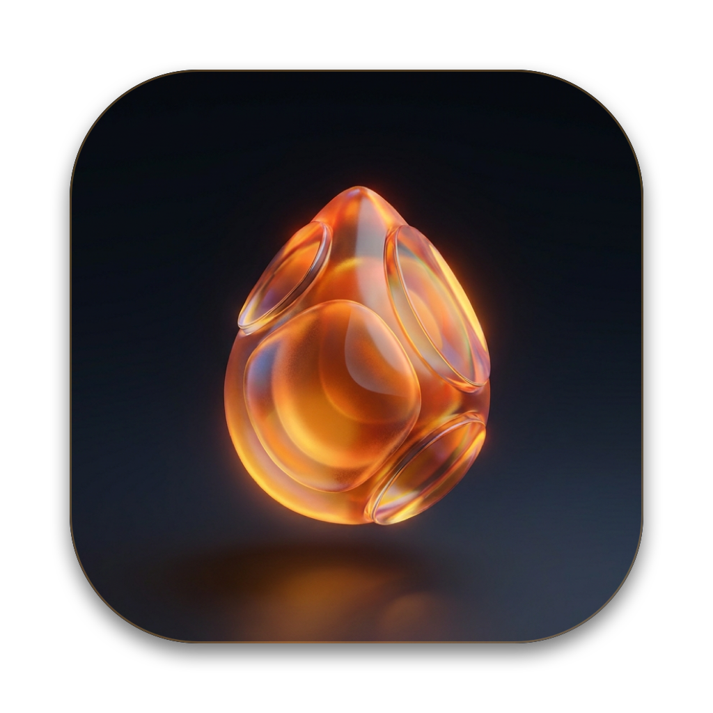

<p align="center">
  
</p>

<h1 align="center">OrangeGel</h1>

<p align="center">
  <strong>Modern Tauri v2 Static Site IDE & Multi-Device Studio</strong><br/>
  Built with <strong>Tauri v2 (Rust)</strong> · <strong>Angular 19 (Signals)</strong> · <strong>Tailwind CSS</strong> · <strong>Lucide</strong> · <strong>Monaco</strong> · <strong>Three.js</strong> · <strong>Anime.js</strong> · <strong>Mermaid</strong>
</p>

<p align="center">
  <a href="https://github.com/orangegel/orangegel">App (orangegel/orangegel)</a> ·
  <a href="https://github.com/orangegel/site">Hugo Site (orangegel/site)</a> ·
  <a href="https://github.com/orangegel/docs">Documentation (orangegel/docs)</a> ·
  <a href="./DESIGN.md">Architecture (DESIGN.md)</a>
</p>

---

## Ecosystem Repositories (`github.com/orangegel`)

| Repository | Purpose | Stack |
|---|---|---|
| **[orangegel/orangegel](https://github.com/orangegel/orangegel)** | The native **OrangeGel** desktop IDE & Multi-Device Preview Studio (this repository) | Tauri v2 (Rust) + Angular 19 (Signals) + Tailwind CSS + Lucide + Monaco + Three.js + Anime.js + Mermaid |
| **[orangegel/site](https://github.com/orangegel/site)** | Official **OrangeGel** product & marketing site (dogfooded with **Hugo**) | Hugo + Tailwind CSS + Three.js + Anime.js + Firebase Hosting |
| **[orangegel/docs](https://github.com/orangegel/docs)** | Official **OrangeGel** user guides, Top-20 SSG adapter docs, and architecture reference | Hugo / Markdown + Mermaid diagrams |

---

## Overview

**OrangeGel** is a native desktop IDE and responsive preview studio for static site authors:

- **Top 20 Jamstack Static Site Generators ([Hugo](https://gohugo.io/) Preferred):** First-class support for **Hugo** (flagship default), **Next.js**, **Docusaurus**, **Nuxt**, **Gatsby**, **Astro**, **Jekyll**, **Hexo**, **VuePress**, **Eleventy (11ty)**, **VitePress**, **MkDocs**, **Zola**, **Pelican**, **SvelteKit**, **Remix**, **Middleman**, **Metalsmith**, **Gridsome**, and **Bridgetown**.
- **Responsive Multi-Device Preview Browser:** Live preview across **Desktop**, **Tablet**, **Mobile**, and **Side-by-Side Compare** viewports with Portrait ⇄ Landscape rotation, Anime.js spring-physics viewport morphing, and WebKit-safe `.viewport-sizer` transform scaling.
- **Three.js 3D Site Topology Graph & Shader Orb:** Interactive 3D force-directed site constellation (`SiteGraph3DComponent`) and custom GLSL hydrogel status orb (`OrangeGelOrbComponent`).
- **Monaco Editor & Live Mermaid Inspector:** Multi-tab Monaco editor with custom TOML & Mermaid grammars, Hugo/Tailwind/Lucide/Mermaid/Three.js/Anime.js/HTMX completions, and live Mermaid diagram rendering (`MermaidPreviewComponent`).
- **Offset-Preserving Prose Checker & Local AI Proofreader:** Mask-then-scan offline Hunspell (`nspell`) + style checker and non-destructive local `/v1/chat/completions` proofreading with word-level diffing.
- **Multi-Provider Static Site Deployment Engine (7 Targets):** First-class visual pipeline and live Mermaid execution graph for **Firebase Hosting (+ optional Cloud Run edge-last origin)**, **GitHub Pages (`gh-pages`)**, **GitLab Pages**, **Cloudflare Pages (`wrangler`)**, **Netlify (`netlify-cli`)**, **Vercel (`vercel`)**, and **AWS S3 + CloudFront (`aws`)**.

## Development & Packaging

```bash
# Run frontend unit tests (Vitest)
npm test

# Run Rust backend unit tests
cargo +1.98.1 test --manifest-path src-tauri/Cargo.toml

# Build production Angular bundle
npm run build

# Build & sign macOS .app and .dmg with Apple Developer ID
npm run dmg:signed
```
